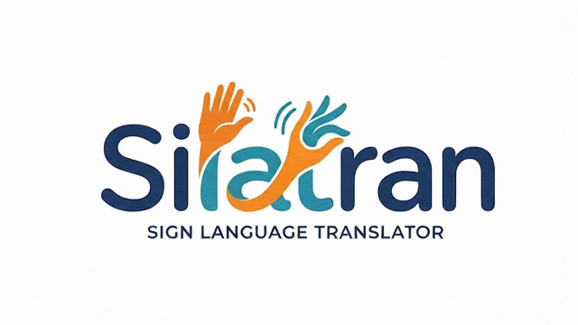
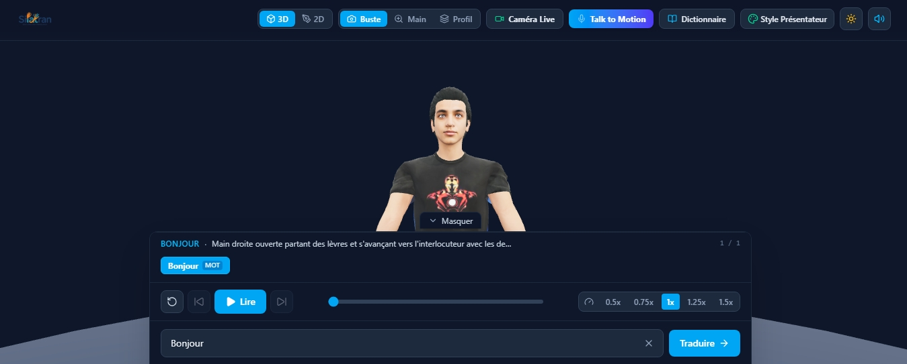

# Silatran — Sign Language Translator

  

  <b>Traducteur interactif de texte en Langue des Signes Française (LSF) avec support 3D & 2D, capture de mouvements en direct par Caméra (MediaPipe & OpenCV), et synthèse vocale avec synchronisation labiale (Lip-Sync).</b>

---

## Présentation de l'Application

**Silatran** (*Sign Language Translator*) est une application web moderne et inclusive conçue pour convertir instantanément du texte en Langue des Signes Française (LSF). Elle offre une double expérience de visualisation (un présentateur 3D réaliste en studio PBR et un mode 2D vectoriel épuré), ainsi qu'une suite complète d'outils d'accessibilité et de capture de mouvement en temps réel.

---

## Aperçu de l'Interface

  

---

## Fonctionnalités Clés

1. **Double Mode de Rendu (3D Temps Réel & 2D Vectoriel)** :
   - **Mode 3D Réaliste (PBR)** : Présentateur 3D articulé avec éclairage de studio 3-points, textures haute-fidélité, et support d'importation de modèles `.glb` / `.gltf`.
   - **Mode 2D Vectoriel** : Scène vectorielle interactive fluide aux illustrations pédagogiques de référence, gérant la cinématique des bras, poignets et des 5 doigts articulés.

2. **Caméra Live & Motion Capture (MediaPipe + TensorFlow.js + OpenCV)** :
   - Capture du flux webcam en direct avec analyse cinématique des mains par **MediaPipe Hands** et **TensorFlow.js WASM**.
   - Superstructure squelettique style **OpenCV** dessinée en temps réel sur Canvas avec codage couleur par doigt et métriques de performance (FPS, boîtes englobantes).
   - Synchronisation instantanée des mouvements de l'utilisateur avec le personnage 3D ou 2D.
   - Mode simulation de démo intégré pour les environnements sans webcam physique.

3. **Fonctionnalité "Talk to Motion" & Lip-Sync** :
   - Entrée textuelle convertie en mouvements corporels d'élocution naturelle (distincts de la LSF).
   - Synthèse vocale intégrée (*Web Speech API*) avec synchronisation labiale (*lip-sync*) en direct sur la bouche du personnage.

4. **Dictionnaire & Personnalisation** :
   - **Dictionnaire Interactif** : Explorez la bibliothèque complète des signes LSF (mots et alphabet dactylologique) avec descriptions détaillées.
   - **Personnalisation de l'Avatar** : Modifiez les teintes de peau, de vêtements, de cheveux et l'apparence du présentateur à la volée.

5. **Expérience Utilisateur Moderne** :
   - Thème Nuit (Dark Mode) et Mode Jour (Light Mode) commutables d'un simple clic.
   - Écran de chargement minimaliste sur fond blanc arborant le logo officiel `Silatran-logo.gif`.
   - Dock ergonomique repliable pour une immersion optimale.

---

## Stack Technique

- **Framework** : React avec TypeScript et Vite.
- **Style** : Tailwind CSS.
- **Rendu 3D** : Three.js avec OrbitControls et RoomEnvironment.
- **Vision par Ordinateur & IA** : `@mediapipe/hands`, `@mediapipe/camera_utils`, `@tensorflow/tfjs`.

---

## Installation

Attendez d‘abord une nouvelle update
---

Ce projet est développé pour favoriser l'inclusion et la traduction accessible de la Langue des Signes.
